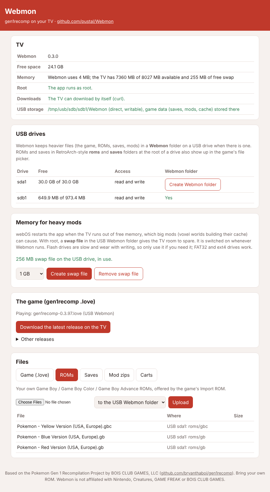

# Webmon


Runs [gen1recomp](https://github.com/bryanthaboi/gen1recomp) (G1R Deluxe) on
LG webOS TVs. gen1recomp is a LÖVE remake of the Game Boy Pokemon games whose
data and graphics are read from your own ROM; Webmon is a native LÖVE 11.5 build
for the TV plus webOS integration: an upload page, USB storage and a file
picker for the game's import screens.

> Based on the Pokemon Gen 1 Recompilation Project by BOIS CLUB GAMES, LLC
> (https://github.com/bryanthaboi/gen1recomp)

Webmon contains no gen1recomp code and no game data. gen1recomp's launcher may
only be distributed in unmodified official releases, so Webmon gets the
official release's `.love` for you (or you add it yourself), and you supply
your own ROM.

## Installing

1. Install `dist/org.webmon.app_<version>_arm.ipk` with
   [webOS Dev Manager](https://github.com/webosbrew/dev-manager-desktop) or
   `ares-install`.
2. Start Webmon. Without the game it shows a setup screen:
   - press **OK** to download the latest gen1recomp release straight onto the
     TV (it restarts into the game when done), or
   - open the upload page address shown there on a phone or computer on the
     same network, enter the PIN and upload or download the `.love`, or
   - copy the `.love` into a folder named `Webmon` on a USB drive.
3. In the game, **Import ROM** opens Webmon's file picker on the TV. It lists
   the ROMs you uploaded, the ones in the USB `Webmon/roms` folder, and the
   Pokemon ones in RetroArch-style `roms/` folders on any USB drive (file names
   with "Pokemon", "Pokémon", "PKMN" or "Pocket Monsters", so a whole collection
   does not crowd the list; put anything else in `Webmon/roms`). Saves work the
   same way (`Webmon/saves`, RetroArch `saves/`, `.sav` or `.srm`), as do mod
   zips and carts.

Press **1** on the remote at any time to show or hide the upload page address
and PIN (it also shows for a few seconds at start).

## The upload page



Port 47811 (or the next free one). It only answers devices on your home
network that send the PIN. It shows:

- **TV**: free space, root access (the app running as root, or root commands
  through the Homebrew Channel), whether the TV can download by itself (curl),
  and which USB drive Webmon uses;
- **USB drives**: free space and access, and a button to create a `Webmon`
  folder on a drive;
- **The game**: download the latest release, or any listed release, onto the
  TV, or download it to your computer;
- **Memory for heavy mods**: the TV's memory, and an optional swap file (below);
- **Mod data**: each game's per-playthrough mod folders, with their size, to
  delete old map caches;
- **Files**: upload, list and delete the game, ROMs, saves, mod zips and carts,
  to TV storage or the USB `Webmon` folder. While the game's picker is open the
  page says what it is waiting for, and new uploads appear in the picker by
  themselves.

The game's own downloads (mod catalogue, updates) also use the TV's curl.

## Where files go

| Place | Contents |
|---|---|
| `<USB>/Webmon/` | the `.love`; `roms/`, `saves/`, `mod-zips/`, `carts/` for the game's import screens |
| `<USB>/Webmon/game-data/` | the game's own data: saves, settings, installed mods and its import cache (the decoded graphics and sound of each imported game, the biggest part). Used when the drive can be written; the first time, the data already on the TV is moved there |
| `<USB>/roms/`, `<USB>/saves/` | RetroArch-style folders (any capitalisation, up to three levels deep): Pokemon titles are listed by the picker, nothing is changed |
| Data folder `game/`, `inbox/`, `save/` | the same, on TV storage, when there is no writable USB `Webmon` folder (or you choose TV storage) |

Keep the drive plugged in: without it Webmon falls back to the game data on TV
storage, which is separate.

When the app cannot read a USB drive itself, Webmon uses root (if available) to
bind-mount the `Webmon` folder into the data folder and to copy picked files.

The data folder is
`/media/developer/apps/usr/palm/applications/org.webmon.app/data`, with
`stdout.log` and `stderr.log`. It survives app updates but not uninstalling.

## Memory and heavy mods

webOS restarts the app when the TV runs short of free memory. Big mods can get
there: a voxel world mod (such as PotatoVoxel) building its map cache creates a
lot of 3D data at once. Webmon helps in two ways:

- **Prompt clean-up.** LÖVE objects (meshes, image data) hold memory that Lua's
  garbage collector does not see, so it would wait too long to free them.
  Webmon checks the process size every second and runs a full clean-up after
  it grows by 48 MB, or when the TV has less than 160 MB available. The log
  (`stdout.log`) records each clean-up and every new peak.
- **A fresh start before the TV freezes.** When the TV still has less than
  130 MB available after three clean-ups in a row, Webmon shows a 15-second
  countdown, then quits the game cleanly and starts again as a new process,
  which hands all its memory back to the TV. OK restarts at once; Back keeps
  playing (it asks again after two minutes if memory stays that low). Unsaved
  progress is lost, but a voxel cache build continues where it stopped, and
  the logs carry on across the restart.
- **A swap file (root, optional).** webOS TVs usually have compressed swap of
  their own (the upload page shows it). The page can add a swap file of 512 MB
  to 2 GB in the USB `Webmon` folder; Webmon switches it on whenever it runs
  and off when it closes. Flash drives are slow and wear with writing, so use
  it only if a mod needs it; FAT32 and ext4 drives work, NTFS cannot hold swap.

If the app is restarted in the middle of a cache build, choose the mod's
prebuild again: PotatoVoxel resumes where it stopped. A lower quality preset
(LOW or POTATO) also needs less memory. A first build can take long enough for
the TV's own power saving to switch it off (LG: Settings > General > System >
Eco / Power Saving, "Auto Power Off"); turn that off for the build or press a
remote button now and then.

Mods keep their data per game and playthrough (`mod_storage/<game>/<id>/` in
the game's data). When the game gives a playthrough a new id, for example after
the app was closed during a build, a voxel mod starts a new cache and the old
one stays behind. The upload page's **Mod data** section lists these folders
with their size and date, and deletes old ones.

## Controls

A game controller works as in gen1recomp. The TV remote:

| Remote | Game | | Remote | Game |
|---|---|---|---|---|
| Arrows | D-pad | | Yellow | Select |
| OK, Green | A | | Blue, 0, Play | Start |
| Back, Red | B | | CH+ / CH- | L / R |
| 1 | Webmon's info panel (upload page address, PIN) | | Exit | Close Webmon |

In Webmon's picker: Up/Down move, Left/Right page, OK chooses, Back cancels.

## Building

You need Linux x86_64 (or a Linux VM/container on macOS), the webosbrew
toolchain ([buildroot-nc4 releases](https://github.com/openlgtv/buildroot-nc4/releases),
run its `relocate-sdk.sh` once), CMake 3.21+, Ninja or make, autoconf,
automake, libtool, pkg-config, git, a 32-bit host compiler (`gcc-multilib`, for
LuaJIT's build tools) and `ares-package` (`npm install -g @webos-tools/cli`).

```sh
export WEBOS_SDK=$HOME/arm-webos-linux-gnueabi_sdk-buildroot
scripts/build-webos.sh
```

`scripts/build-deps.sh` builds LÖVE 11.5 and its libraries from pinned sources
(LuaJIT at the commit gen1recomp pins, OpenAL Soft with SDL2 output, FreeType,
Ogg/Vorbis/Theora, modplug) into `third_party/deps-work/`. The IPK lands in
`dist/`.

Tests that run without a TV:

- `tools/server-harness/run.sh <scratch folder>` runs the upload page with the
  host compiler (open `http://localhost:47811`);
- `lua5.1 tools/bridge-test/test.lua src/lua/bridge.lua` checks the picker.

## How it works

| Part | What it does |
|---|---|
| `src/main.cpp` | LÖVE's own `main` (from `src/love.cpp`) plus the webOS start-up; runs the newest `.love` or the setup screen, and again after the game asks LÖVE to restart |
| `src/webos/Platform.cpp` | Data folder, logs, the remote mapped onto the game's keys, the info panel key |
| `src/webos/Usb.cpp` | Root detection (Homebrew Channel exec), USB drives, the `Webmon` folder |
| `src/webos/Library.cpp` | Where files live, linking the USB `Webmon` folder, the game's data folder (`XDG_DATA_HOME`), file lists including RetroArch folders |
| `src/webos/Downloader.cpp` | Downloads gen1recomp releases with the TV's curl |
| `src/webos/Memory.cpp`, `src/webos/Swap.cpp` | Memory figures; the optional USB swap file (root) |
| `src/server/WebServer.cpp`, `web/index.html` | The upload page (cpp-httplib) |
| `src/webos/LuaBridge.cpp`, `src/lua/bridge.lua` | Lua API for the game and setup screen; the file picker gen1recomp asks for (`love.system.pickFile` / `getPickedFile`) and the info panel |
| `setup/` | The setup screen (Lua) |

## Licence

MIT (see [LICENSE](LICENSE)) for Webmon's own code. See
[THIRD_PARTY_NOTICES.md](THIRD_PARTY_NOTICES.md) for the bundled libraries.
Pokemon and all related names are the property of Nintendo, Creatures Inc. and
GAME FREAK inc. Webmon is not affiliated with them or with BOIS CLUB GAMES.
